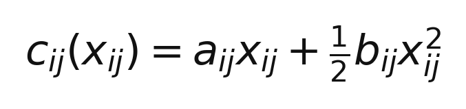
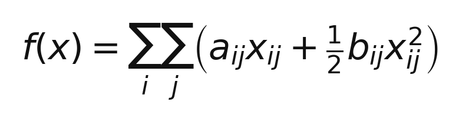
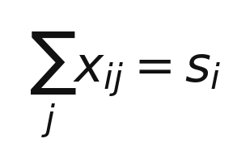
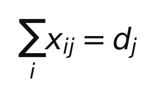
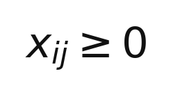
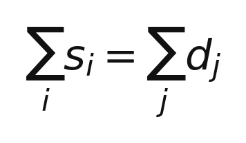
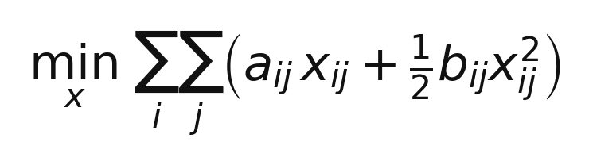

# ЛР 2. Транспортная задача с квадратичной стоимостью

## О лабораторной работе

Цель лабораторной работы — рассмотреть транспортную задачу, в которой стоимость перевозки зависит не только от количества груза, но и от нагрузки на маршрут.

В классической транспортной задаче стоимость перевозки единицы груза обычно считается постоянной. В этой работе используется квадратичная функция стоимости: по мере увеличения объёма перевозки расходы на дополнительную единицу груза могут возрастать.

Для каждой пары пунктов отправления и назначения стоимость перевозки объёма `x_ij` задаётся функцией:

Общая стоимость перевозок:

Здесь `x_ij` — объём груза, перевозимый из пункта отправления `i` в пункт назначения `j`.

## 1. Физический смысл и постановка задачи

### Что означают параметры стоимости

- **`a_ij` — базовый тариф.** Отражает основные затраты на перевозку единицы груза по маршруту из пункта `i` в пункт `j`. Например, он может учитывать расстояние, топливо и обычные транспортные расходы.
- **`b_ij` — коэффициент роста затрат.** Описывает, насколько быстро увеличиваются дополнительные затраты при росте объёма перевозки по маршруту. Большое значение `b_ij` означает, что интенсивное использование маршрута становится относительно дорогим. Это можно интерпретировать как перегрузку транспорта, ограниченную пропускную способность или необходимость привлекать дополнительные ресурсы.

Таким образом, линейная часть `a_ij * x_ij` описывает базовые расходы, а квадратичная часть `(1/2) * b_ij * x_ij^2` учитывает рост затрат при увеличении объёма перевозки.

### Ограничения транспортной задачи

Обозначим:

- `s_i` — запас груза в пункте отправления `i`;
- `d_j` — потребность в грузе в пункте назначения `j`;
- `x_ij` — объём перевозки по маршруту `i → j`.

Если весь запас должен быть отправлен, а вся потребность — удовлетворена, ограничения имеют вид.

Для каждого пункта отправления `i` весь имеющийся запас должен быть вывезен:

Для каждого пункта назначения `j` должна быть удовлетворена потребность:

Объёмы перевозок не могут быть отрицательными:

Для сбалансированной транспортной задачи суммарный запас должен равняться суммарному спросу:

Если это равенство выполняется, общего количества груза достаточно для удовлетворения всей потребности без избытка или дефицита.

### Итоговая математическая постановка

Необходимо найти объёмы перевозок `x_ij`, которые минимизируют общую стоимость:

при ограничениях на запасы, спрос и неотрицательность перевозок.

При `b_ij >= 0` квадратичная составляющая неотрицательно выпукла, поэтому функция стоимости выпукла. Это важно для методов оптимизации: при выполнении условий выпуклости найденный глобальный минимум не хуже любого другого допустимого решения.
